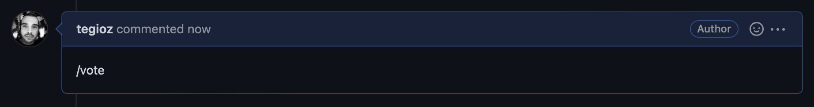
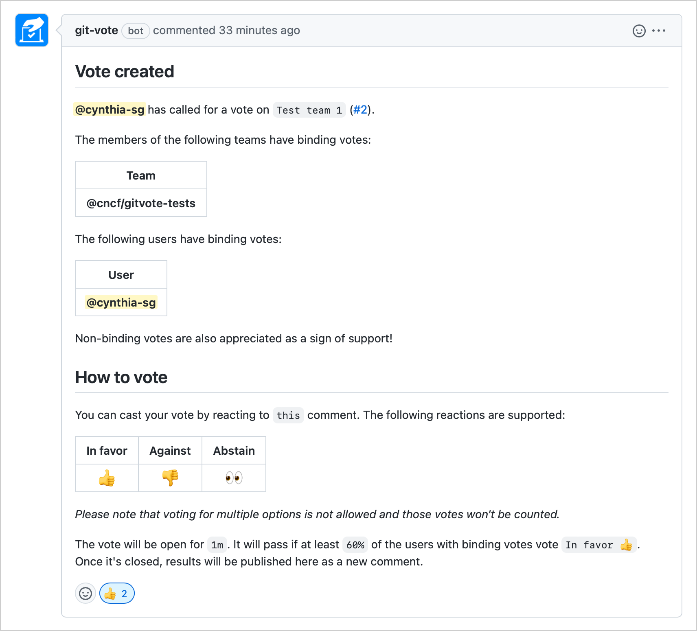
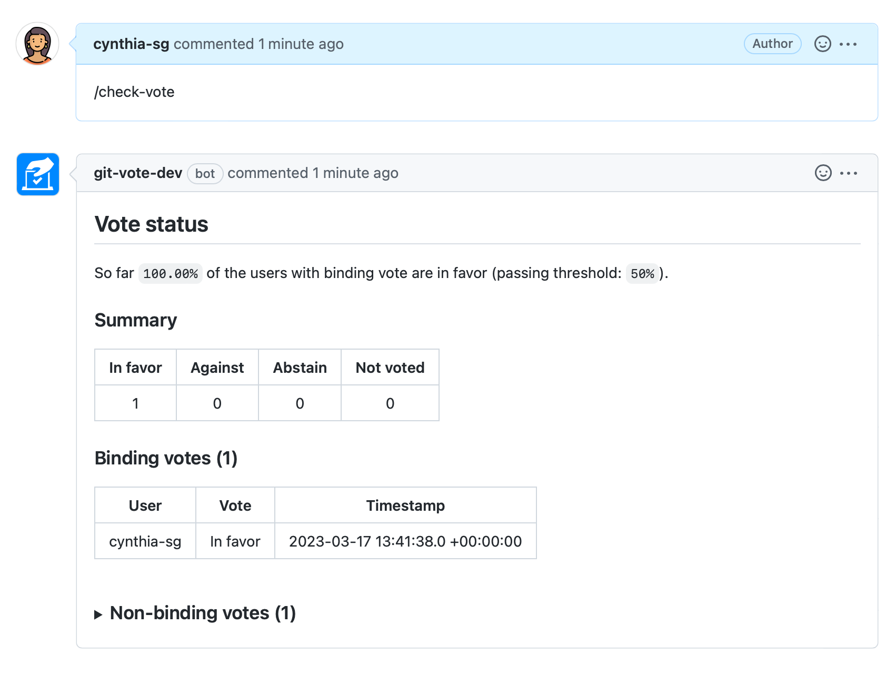
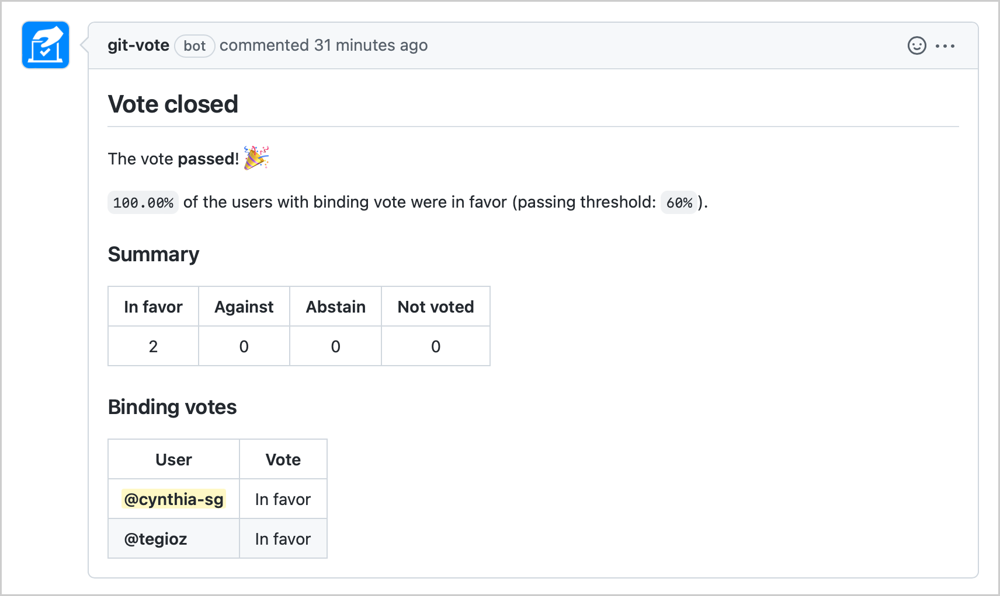
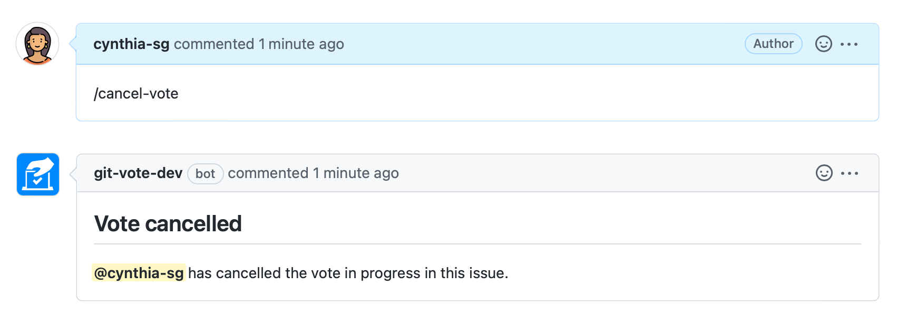
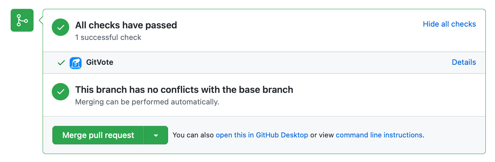

# GitVote

[](https://artifacthub.io/packages/helm/gitvote/gitvote)

**GitVote** is a GitHub application that allows holding a vote on *issues* and *pull requests*.

## Usage

The first step is to install the [GitVote GitHub application](https://github.com/apps/git-vote) in the organization or repositories you'd like. Alternatively, you can deploy your own instance of the GitVote service by using [the Helm chart provided](https://artifacthub.io/packages/helm/gitvote/gitvote) (some organizations may prefer this option for private repositories).

Once the application has been installed we can proceed with its configuration.

### Configuration

To create votes, you'll first need to add a [.gitvote.yml](https://github.com/cncf/gitvote/blob/main/docs/config/.gitvote.yml) configuration file. GitVote will look for it in the following locations (in order of precedence):

- At the root of the repository where the vote was created
- In the `.github` directory of the repository where the vote was created
- At the root of the `.github` repository, for organization wide configuration

> [!IMPORTANT]
> Please note that the configuration file is **required** and no commands will be processed if it cannot be found. Once a vote is created, the configuration it will use during its lifetime will be the one present at the vote creation time.

For more information about the configuration file format please see the [reference documentation](https://github.com/cncf/gitvote/blob/main/docs/config/.gitvote.yml).

### Creating votes

Votes can be created by calling the `/vote` command on an *issue* or *pull request*. This can be done by:

- adding the **/vote** command to the *issue* or *pull request* body at creation time
- adding a new comment to an existing *issue* or *pull request* with the **/vote** command in it

The command **must** be on a line by itself. Please note that GitVote only detects commands in issues or pull requests bodies when they are opened, or when comments are created, *not when any of them are edited*.



Alternatively, if you have setup multiple configuration profiles, you can also start votes using any of them with the command `/vote-PROFILE`. The profile name can contain letters, digits, hyphens and underscores, and it must follow the hyphen: lines like `/votes` or `/vote-` are not commands.

> [!NOTE]
> Only repositories collaborators can create votes. For organization-owned repositories, the list of collaborators includes outside collaborators, organization members that are direct collaborators, organization members with access through team memberships, organization members with access through default organization permissions, and organization owners.

Shortly after the comment with the `/vote` command is posted, the vote will be created and the bot will post a new comment to the corresponding issue or pull request with the vote instructions.

The `duration` of a vote is set in the configuration profile used. It must be at least 1 second, and it cannot be greater than 36500 days. Otherwise no vote is created and the bot posts a comment saying the configuration is invalid.



#### Automation

GitVote allows votes to be created automatically on pull requests when any of the files affected matches certain predefined patterns. For more information about how to set it up, please see the automation section in the [reference documentation](https://github.com/cncf/gitvote/blob/main/docs/config/.gitvote.yml).

> [!IMPORTANT]
> Automatic votes are subject to the same rule as the ones created with the `/vote` command: the user who opens the pull request must be a repository collaborator. When a pull request from any other user matches an automation rule, no vote is created and GitVote posts a comment saying so. In that case, a collaborator can start the vote by calling the `/vote` command.

If the automation rules cannot be evaluated when a pull request is opened (for example, because the configuration file is invalid), or the vote they request cannot be created because of an unexpected failure, no vote is created. GitVote reports a failed check and posts a comment asking maintainers to call the `/vote` command if a vote is needed.

### Voting

Users can cast their votes by reacting to the `git-vote` bot comment where the vote was created (screenshot above).

It is possible to vote `in favor`, `against` or to `abstain`, and each of these options can be selected with the following reactions:

| In favor | Against | Abstain |
| :------: | :-----: | :-----: |
|    👍     |    👎    |    👀    |

Only votes from users with a binding vote as defined in the configuration file will be counted.

> [!WARNING]
> Voting multiple options is not allowed and those votes won't be counted.

### Checking votes

It is possible to check the status of a vote in progress by calling the `/check-vote` command (this command does not accept a suffix):



> [!NOTE]
> This command can only be called once a day per vote (additional calls will be ignored).

### Closing votes

Once the vote time is up, the vote will be automatically closed and the results will be published in a new comment.



If the results cannot be calculated when the vote time is up, for example because GitHub is not available, GitVote keeps trying until it can, waiting up to 6 hours between attempts. The vote is closed once its results are calculated. If publishing them fails (the comment, check, labels or announcement), GitVote retries the parts missing for about 20 hours, and leaves them as they are after that. The results comment and announcement, as well as the cancellation comment, include a hidden marker that identifies the vote, so that a retry finds them instead of posting them again when a previous attempt did post them.

Reactions added after the end of the vote are ignored, even if the vote takes a while to be closed. When the vote is closed early because of the `close_on_passing` feature, its end is the moment it was closed.

> [!NOTE]
> GitHub does not keep track of removed reactions, so removing a reaction after the end of the vote cannot be detected. If that happens before the results are calculated, that reaction will not be counted.

### Cancelling votes

It is possible to cancel a vote in progress by calling the `/cancel-vote` command (this command does not accept a suffix):



The vote is cancelled as soon as the command is processed, and a new vote can be created right away. If the cancellation cannot be published on GitHub at that moment, GitVote retries publishing it for about 20 hours. When a newer vote exists, only the comment of the cancellation is posted, so that the check and labels of the newer vote are left alone.

If the cancellation still cannot be published after those 20 hours, it is abandoned, and the parts not published yet are left as they are: the cancellation comment may be missing, the `gitvote/open` label may still be on the issue or pull request, and a pull request may keep the in-progress check of the cancelled vote. To clean them up, start a new vote with `/vote` and cancel it with `/cancel-vote` once GitHub is available again, or remove the label by hand. When the check is required and the pull request has no other vote, pushing a new commit also reports a new check on it.

### Checks in pull requests

When a vote on a pull request is closed, GitVote will add a check with its result to the commit at the head of the pull request at that moment. Commits pushed after the vote is closed do not get that check, even if publishing it has to be retried. The exception is when the head of the pull request cannot be read as the vote closes: the check is then added to the head at the time it is published, which may be a later commit. If the vote passes, the result of the check will be *success*, whereas if it doesn't pass, it'll be *failure*. When used in combination with `protected branch`, this feature can be used to *require* a vote in favor before a pull request can be merged.

The result of the check will also be *failure* if the vote closes without results, which happens when its comment cannot be found. The check will ask to run `/vote` again to start a new vote.



When the check is required in the target branch and a pull request has no vote, GitVote reports it on each push. The check passes unless an automation rule matches the pull request or the rules cannot be evaluated, in which case it fails. No vote is started on a push, so a vote has to be created with the `/vote` command. This also applies to pull requests where an automatic vote was cancelled.

### Announcements

GitVote is able to post announcements on GitHub discussions. When this feature is enabled, a new discussion will be created with the results of the vote once it is closed.

Announcements can be configured per vote profile, by adding the `announcements` configuration section to the `.gitvote.yml` file.

```yaml
announcements:
  discussions:
    category: announcements  # Category slug (i.e. spaces are replaced by hyphens)
```

> [!NOTE]
> This feature requires some extra permissions to be able to read and write discussions in your repositories. If you installed the GitVote GitHub application before this feature was available (June 2024), you should receive an email from GitHub requesting you to approve these new permissions. Please note that announcements won't be created until those permissions are granted.

### Audit

The audit page publishes the history of votes and some participation stats for a repository. It is disabled by default; to enable it, add the `audit` section with `enabled: true` to your `.gitvote.yml` (see the reference configuration in [`docs/config/.gitvote.yml`](docs/config/.gitvote.yml) for more details).

Once the audit feature is on, GitVote serves the page at `https://gitvote.dev/audit/OWNER/REPO`. The page is public, so anyone can review the voting log.

> [!NOTE]
> It can take up to 15 minutes after enabling the option for the audit page to become available.

## Adopters

Please see [ADOPTERS.md](./ADOPTERS.md) for more details.

## Contributing

Please see [CONTRIBUTING.md](./CONTRIBUTING.md) for more details.

## Code of Conduct

This project follows the [CNCF Code of Conduct](https://github.com/cncf/foundation/blob/master/code-of-conduct.md).

## License

GitVote is an Open Source project licensed under the [Apache License 2.0](https://www.apache.org/licenses/LICENSE-2.0).
